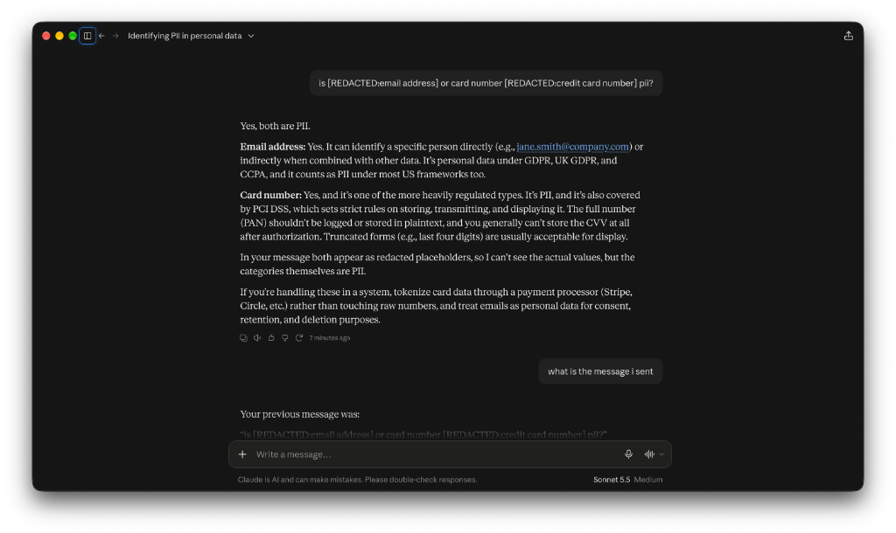

# I Built a macOS App That Stops You Accidentally Handing Your Secrets to AI Agents

It was half past two on a Tuesday morning. The office was quiet, the kettle had boiled for the fifth time, and my code refused to cooperate. 

Like every developer trying to meet a tight deadline, I did the classic modern programmer dance. I grabbed a chunky block of debugging logs, opened my favourite generative AI assistant, and pasted the entire mess into the prompt window.

Just as my thumb smacked the return key, my stomach did a proper somersault. Tucked neatly inside line forty two of that stack trace was an active payment gateway secret key and the real email address of a very confused customer from Yorkshire.

We have all been there. It is the digital equivalent of waving enthusiastically at a stranger who was actually waving at someone behind you, only with significantly higher regulatory fines.

We love our AI assistants. We use large language models, autonomous coding agents, and terminal copilots every single working day. Yet every time we copy and paste an error log, a secret environment snippet, or a curl command, we are playing high stakes poker with sensitive data.

I did not want to stop using AI tools, but I also did not fancy explaining an accidental data leak to our security team before breakfast. So I built **PIIGuard AI**, a lightweight native macOS app that sits in your menu bar and acts as an intelligent bodyguard for your prompts.


*Caption: PIIGuard AI running quietly in the background, keeping track of intercepted AI requests and protection metrics.*

***

### The Problem With Human Vigilance

The standard advice for protecting sensitive data is laughably inadequate. People will tell you to simply be careful. Read through every prompt before you click submit, they say. Sanitise your inputs by hand, they suggest.

To that, I say: have you ever met a weary engineer two hours past their bedtime trying to diagnose a broken database migration?

Relying on human willpower to catch personally identifiable information is like trusting a chocolate teapot to hold boiling water. Sooner or later, someone will accidentally upload an internal cloud credential, a telephone number, or a customer record into a cloud model. Once those tokens hit an external server, you cannot take them back.

I wanted something that caught mistakes automatically, running entirely on my Mac, without sending a single byte of my private data to any third party server.

***

### How It Works Under the Bonnet

To make protection truly effortless, it had to work seamlessly across every way developers interact with modern AI models:

1. In the browser when chatting with generative AI web interfaces.
2. In the terminal when running autonomous AI agents, coding assistants, or command line scripts.
3. Inside IDEs like VS Code and Cursor.


*Caption: Autonomous AI agents and coding tools route their outbound prompts through the local proxy without manual fiddling.*

Here is the clever bit. You do not want a heavy VPN or a global proxy that slows down your entire network. Nobody wants their Spotify music stream or routine git pushes rerouted through a local scanner.

Instead, PIIGuard AI creates a lightweight local proxy that selectively listens only to external AI endpoints. 

For web browsers, it serves a dynamic Proxy Auto Configuration script directly to macOS. The system checks this script and says: if the destination is a known generative AI domain, route it through PIIGuard. If the destination is anything else, send it straight to the web with zero latency.

For the command line, the app generates a neat environment file that automatically configures your terminal sessions. AI agent tools and CLI runners immediately respect the proxy without any manual configuration.

***

### Meet Auto Redaction

Initially, my instinct was to simply block any request that contained sensitive data. If an email address or a credit card appeared, PIIGuard would return an instant HTTP 403 Forbidden status and show a notification on your desktop.

That certainly kept data safe, but it also completely interrupted your problem solving flow. What if you actually needed the AI model to help solve the logic bug in that snippet?

This led to my favourite feature: **Auto Redaction**.

When enabled, the local proxy unpacks the incoming request, scans the body for sensitive information using regex patterns and validation algorithms, and automatically masks the sensitive parts on the fly.

If you paste:
```text
Please check why user john.smith@company.co.uk failed to charge card 4242 4242 4242 4242
```

The AI model receives:
```text
Please check why user [REDACTED:email address] failed to charge card [REDACTED:credit card number]
```


*Caption: Real sensitive values masked inline into safe tokens before leaving the laptop.*

The generative AI still understands the context, the prompt completes without a hitch, and your customer data never leaves your laptop. As a certain fictional secret agent might say, it leaves shaken data, not stirred.

***

### Built With Native Mac Craftsmanship

Because I spend all day working on macOS, I could not bear to make this look like a clunky utility. 


*Caption: Quick switching between Auto Redact and Block mode directly from the menu bar.*

The entire app is written in Swift and SwiftUI, following Apple Human Interface Guidelines. It features:

* A clean menu bar popover showing real time protection status and a quick toggle between Auto Redact and Block mode.
* A native Settings dashboard complete with an activity feed, custom provider toggles, and privacy metrics.
* Zero data collection. Everything from token scanning to activity logging happens purely in memory and inside your local Application Support folder.

***

### Wrapping Up

Generative AI and autonomous agents are the best things to happen to developer productivity in years, but speed should never come at the expense of privacy. 

Building PIIGuard AI was about creating a dependable safety net so developers can move fast without that lingering dread of whether they just sent a production database password into an external training queue.

If you want to keep your secrets private and your security team smiling, you can find the complete open source project on GitHub:

👉 [github.com/fujahgabriel/PIIGuardAI](https://github.com/fujahgabriel/PIIGuardAI)

Now, if you will excuse me, that kettle is calling again. Happy coding!
